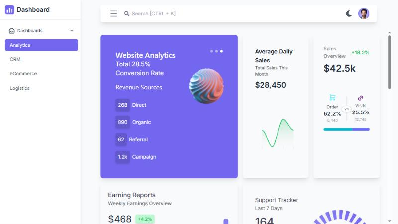
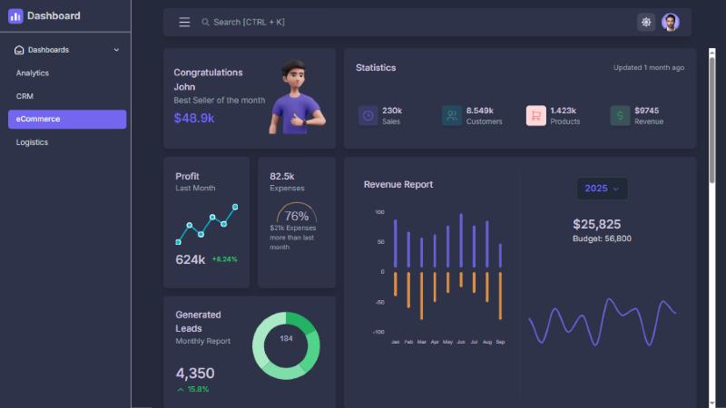
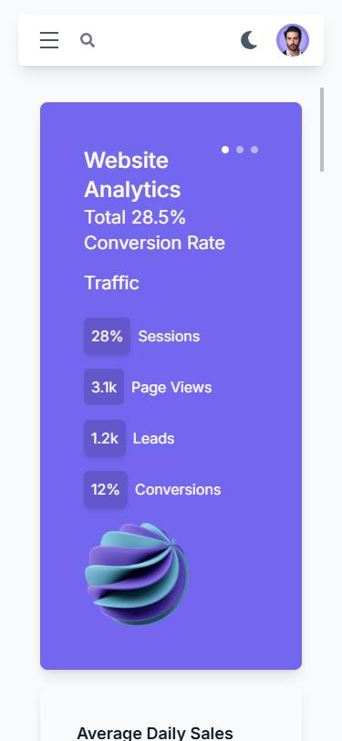

# React Admin Dashboard

A responsive admin dashboard built with React and TypeScript. I recreated the layout of the Vuexy admin template to practice building complex interfaces: charts, data tables, theming and responsive layouts. It uses static sample data and has no backend.



## Features

- **Four dashboard pages:** Analytics, CRM, eCommerce and Logistics
- **Light and dark mode,** remembered between visits
- **Collapsible sidebar,** which becomes a slide-over menu on mobile
- **Page search** in the navbar (press `Ctrl + K` to focus it)
- **Interactive tables** with search, status filter, pagination and row deletion
- **Charts** built with ApexCharts (bar, line, area, radial, donut and radar)
- **Responsive layout** from phone to desktop

## Screenshots

| Dark mode (eCommerce) | Mobile (Analytics) |
| --- | --- |
|  |  |

## Tech stack

- React 19 and TypeScript
- Vite
- Tailwind CSS and Material UI
- ApexCharts (`react-apexcharts`)
- React Router

## Getting started

Requires Node.js 18 or newer.

```bash
npm install
npm run dev
```

Then open http://localhost:5173.

Other scripts:

```bash
npm run build    # type-check and create a production build
npm run lint     # run ESLint
npm run preview  # preview the production build
```

## Project structure

```
src/
  components/   Reusable UI pieces, grouped by page (CRM, eCommerce, logistics)
  pages/        Route-level pages
  assets/       Icons and images
```

## Notes

- All data is hard-coded sample data. The tables and filters work on that data in the browser only.

## Credits

The visual design is based on the Vuexy admin template by Pixinvent. This project is a learning exercise and is not affiliated with or endorsed by them. The code in this repository was written by me.
